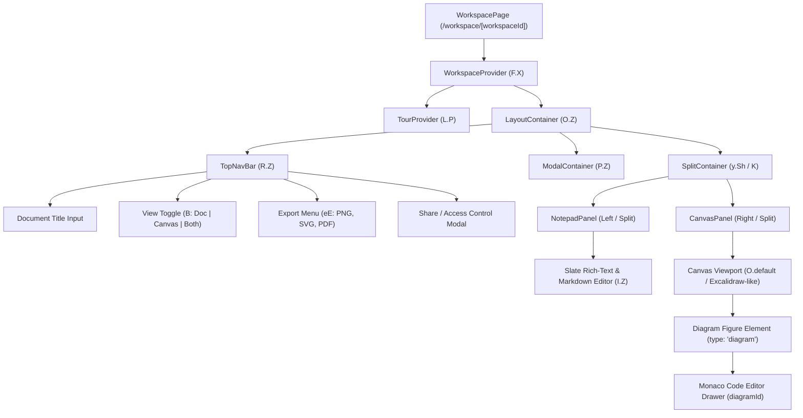

# Eraser Clone (Eraser Workspace) Reconnaissance & Architecture Specification

> **Analysis Authority**: Shipped public client-side JavaScript bundles, CSS assets, Next.js build manifests, and entry HTML extracted from `app.eraser.io` (Build ID: `D7umDKa0U3uvwj7IuRWkM`).  
> **Methodology**: Static reverse engineering utilizing REA (`analyze_javascript_application`, `inspect_analysis_view`, `trace_application_feature`) and AST pattern extraction across 164 JavaScript chunks (15.00 MB total).

---

## 1. Application Overview & Route Inventory

`app.eraser.io` is built on Next.js (Pages Router) with a hybrid architecture:
- Static / SSR frontend shell serving client chunk bundles.
- Real-time collaborative workspace canvas powered by an internal reactive `DataLayer` (backing WebSocket / Firestore subscriptions).
- Backend REST / streaming API served under `/api/*`.

### Route & Screen Manifest `[CONFIRMED FROM CODE]`
*(Extracted from `_buildManifest.js` and confirmed against page chunk initializers)*

| Route Path | Bundle Chunk | Description & Screen Purpose | Status |
| :--- | :--- | :--- | :--- |
| `/workspace/[workspaceId]` | `pages/workspace/[workspaceId]-*.js`, `5877.*.js` | **Core Workspace Editor**: Dual-pane layout with Slate markdown notes + interactive diagram canvas + Monaco diagram-as-code editor. | `[CONFIRMED FROM CODE]` |
| `/workspace/[workspaceId]/embed` | `pages/workspace/[workspaceId]/embed-*.js` | Read-only embedded viewer for iframes (Confluence, Notion, third-party sites). | `[CONFIRMED FROM CODE]` |
| `/workspace/[workspaceId]/image` | `pages/workspace/[workspaceId]/image-*.js` | OpenGraph / dynamic social preview image generation endpoint. | `[CONFIRMED FROM CODE]` |
| `/dashboard/all` | `pages/dashboard/all-*.js` | Workspace file manager: list all files, folders, search, and recents. | `[CONFIRMED FROM CODE]` |
| `/dashboard/recents` | `pages/dashboard/recents-*.js` | Recently accessed files and diagrams. | `[CONFIRMED FROM CODE]` |
| `/dashboard/archived` | `pages/dashboard/archived-*.js` | Soft-deleted / archived workspace files. | `[CONFIRMED FROM CODE]` |
| `/dashboard/folder/[folderId]` | `pages/dashboard/folder/[folderId]-*.js` | Folder view containing child documents and diagrams. | `[CONFIRMED FROM CODE]` |
| `/dashboard/search` | `pages/dashboard/search-*.js` | Algolia-backed granular search across diagram titles, nodes, and notes. | `[CONFIRMED FROM CODE]` |
| `/dashboard/style-preset` | `pages/dashboard/style-preset-*.js` | Style preset customizer (colors, typography, stroke modes). | `[CONFIRMED FROM CODE]` |
| `/new` | `pages/new-*.js` | Quick-create trampoline routing to a newly generated `workspaceId`. | `[CONFIRMED FROM CODE]` |
| `/playground` | `pages/playground-*.js` | Interactive AI diagram generator playground with streaming output. | `[CONFIRMED FROM CODE]` |
| `/render` | `pages/render-*.js` | Headless rendering pipeline for SVG/PNG export generation. | `[CONFIRMED FROM CODE]` |
| `/pdf-view` | `pages/pdf-view-*.js` | In-browser PDF generation preview container. | `[CONFIRMED FROM CODE]` |
| `/dom-canvas` | `pages/dom-canvas-*.js` | Virtual DOM to canvas element rasterization sandbox. | `[CONFIRMED FROM CODE]` |

---

## 2. Editor Component Hierarchy & State Shape

The workspace editor (`Module 84743` in `5877.0795dd938e7c3f5e.js`) renders a split dual-pane workspace with bidirectional synchronization:



### State Models `[CONFIRMED FROM CODE]`

#### Workspace Document Model
```typescript
interface WorkspaceDocument {
  id: string;               // Unique workspace file ID (e.g., 'HU9NtQwI9481irs31zNy')
  title: string;            // Document title (defaults to "Untitled")
  teamId: string;           // Workspace group (fixed default in our clone)
  ownerId: string;          // User ID (fixed default in our clone)
  isReadOnly: boolean;      // Access mode
  directAccessMode: "read" | "write" | "none";
  isAnonymousAccessAllowed: boolean;
  folderId: string | null;
  createdAt: number;
  updatedAt: number;
}
```

#### Dual-Pane Layout State
```typescript
enum LayoutMode {
  Document = 0, // Doc pane only
  Canvas = 1,   // Canvas pane only
  Both = 2      // Split view (default on desktop >= 1024px)
}

interface EditorLayoutState {
  layout: LayoutMode;
  visibilities: [boolean, boolean]; // [isDocVisible, isCanvasVisible]
  isNotepadReady: boolean;
  isWhiteboardReady: boolean;
}
```

#### Canvas & Diagram Entity Model
```typescript
interface DiagramCanvasElement {
  id: string;                       // Unique element ID
  type: "diagram";                  // Element classification
  diagramType: DiagramType;         // FLOW, CAD, ERD, SD, BPMN, FREEFORM
  code: string;                     // Raw diagram-as-code text
  x: number;                        // Canvas stage X position
  y: number;                        // Canvas stage Y position
  width: number;                    // Computed bounding width
  height: number;                   // Computed bounding height
  elements: CanvasChildElement[];   // Generated shapes, text, edges
}

interface CanvasChildElement {
  id: string;
  diagramId: string;                // Foreign key referencing parent DiagramCanvasElement
  type: "rectangle" | "diamond" | "cylinder" | "line" | "text" | "group";
  x: number;
  y: number;
  width: number;
  height: number;
  color?: string;
  label?: string;
  icon?: string;
  sourceLineNumber?: number;        // Direct link back to code line for 2-way sync
}
```

---

## 3. Diagram-as-Code Language Specification

Eraser implements a custom diagram DSL parsed client-side using a LALR parser (`Module 36209` for Flowchart/CAD and `Module 13095` for Sequence diagrams).

### Supported Diagram Types `[CONFIRMED FROM CODE]`
*(Extracted from `Module 31632` and `Module 37077`)*

1. **`flowchart-diagram` (`FLOW`)**: General flowcharts, decision trees, directional steps. Default direction: `"down"`.
2. **`cloud-architecture-diagram` (`CAD`)**: Cloud architectures (AWS, Azure, GCP), microservices, nested infrastructure tiers. Default direction: `"right"`.
3. **`sequence-diagram` (`SD`)**: Actors, participants, signals, lifelines, activation, loops, alternatives (`alt/else`), parallel tracks.
4. **`entity-relationship-diagram` (`ERD`)**: Tables, fields, primary/foreign keys, cardinality lines (`1:1`, `1:N`, `N:1`, `N:M`).
5. **`bpmn-diagram` (`BPMN`)**: Business process notation steps, gateways, and events.
6. **`freeform-diagram` (`FREEFORM`)**: Hybrid diagram combining freehand drawing and structured blocks.

### Global Directives & Properties `[CONFIRMED FROM CODE]`
*(Extracted from `Module 57806`)*

- `title <string>`: Sets the diagram heading.
- `direction <up | down | left | right>`: Sets graph layout orientation.
- `colorMode <pastel | bold | outline>`: Node color fill styling (default: `pastel`).
- `styleMode <plain | shadow | watercolor>`: Visual effect filter (default: `shadow`).
- `typeface <rough | clean | mono>`: Typography family (default: `rough`).
- `textSize <small | medium | large>`: Font scale multiplier (small: `1.0`, medium: `1.2`, large: `1.4`).
- `autoNumber <on | off | nested>`: Sequence diagram signal numbering.
- `notation <crows-foot | chen>`: ERD relationship arrowhead representation (default: `chen` / `crows-foot`).
- `layout <compact | sequential>`: Node spacing density.
- `wrap <on | off>`: Automatic text wrap on nodes and connections.

### Color Palette `[CONFIRMED FROM CODE]`
*(Extracted from `Module 57806` and `Module 50986`)*:
`pastel` / `bold` palettes support:
- `blue`, `green`, `red`, `orange`, `purple`, `yellow`, `black`, `white`

### Shapes Inventory `[CONFIRMED FROM CODE]`
*(Extracted from `Module 35731`)*:
- `rectangle`, `parallelogram`, `trapezoid`, `diamond`, `cylinder`, `hexagon`, `circle`, `ellipse`, `oval`, `triangle`, `document`, `star`

### Connection Syntax & Symbols `[CONFIRMED FROM CODE]`
*(Extracted from `Module 35731` and `Module 67713`)*:

| Symbol Syntax | Relationship Type | Visual Arrowhead | Diagram Context |
| :--- | :--- | :--- | :--- |
| `>` or `->` | `FORWARD` | Solid arrow forward | Flowchart, CAD, Sequence |
| `-->` | `FORWARD_DASHED` | Dashed arrow forward | Flowchart, CAD, Async Sequence |
| `<` or `<-` | `BACKWARD` | Solid arrow backward | Flowchart, CAD |
| `<--` | `BACKWARD_DASHED` | Dashed arrow backward | Flowchart, CAD |
| `<>` or `<->` | `BIDIRECTIONAL` | Solid double arrow | Flowchart, CAD, ERD (Many-to-Many) |
| `<-->` | `BIDIRECTIONAL_DASHED`| Dashed double arrow | Flowchart, CAD |
| `-` | `UNDIRECTED` | Solid plain line | Flowchart, CAD, ERD (One-to-One) |
| `--` | `UNDIRECTED_DASHED` | Dashed plain line | Flowchart, CAD |

---

## 4. Formal Grammar (EBNF) `[CONFIRMED FROM CODE]`

Below is the formal Extended Backus-Naur Form (EBNF) derived directly from the extracted parser terminals, tokens, and production rules in `Module 36209`, `Module 13095`, and `Module 3382`:

```ebnf
(* ========================================== *)
(* Eraser Diagram-as-Code Formal Grammar     *)
(* ========================================== *)

DiagramDocument ::= { Statement | Newline } EOF ;

Statement ::= GlobalDirective
            | NodeDeclaration
            | GroupDeclaration
            | ConnectionDeclaration
            | SequenceBlock
            | SequenceOrder
            | SequenceActivation
            | ErdTableDeclaration
            | LegendDeclaration
            | Comment ;

(* --- Global Directives --- *)
GlobalDirective ::= TitleDirective
                  | DirectionDirective
                  | StyleSettingDirective ;

TitleDirective       ::= "title" [ ":" ] Text ;
DirectionDirective   ::= "direction" [ ":" ] ( "up" | "down" | "left" | "right" ) ;
StyleSettingDirective ::= SettingKey [ ":" ] SettingValue ;

SettingKey   ::= "colorMode" | "styleMode" | "typeface" | "textSize" 
               | "autoNumber" | "notation" | "layout" | "wrap" ;
SettingValue ::= Ident | StringLiteral ;

(* --- Node Declarations --- *)
NodeDeclaration ::= NodeIdentifier [ AttributeBlock ] ;

NodeIdentifier ::= Ident | QuotedIdent ;
QuotedIdent    ::= '"' [^"\r\n]+ '"' ;

AttributeBlock ::= "[" [ AttributeList ] "]" ;
AttributeList  ::= Attribute { ( "," | ";" ) Attribute } ;
Attribute      ::= AttributeKey ":" AttributeValue ;

AttributeKey   ::= "icon" | "color" | "shape" | "label" | "link" | "wrap" ;
AttributeValue ::= Ident | StringLiteral ;

(* --- Groups --- *)
GroupDeclaration ::= GroupIdentifier [ AttributeBlock ] "{" { Statement | Newline } "}" ;
GroupIdentifier  ::= Ident | QuotedIdent ;

(* --- Connections & Edges --- *)
ConnectionDeclaration ::= NodeTargetList ConnectionOperator NodeTargetList [ ":" [ ConnectionLabel ] [ AttributeBlock ] ] ;

NodeTargetList     ::= NodeTarget { "," NodeTarget } ;
NodeTarget         ::= NodeIdentifier [ "." MemberIdentifier ] ;
MemberIdentifier   ::= Ident ;

ConnectionOperator ::= ">" | "->" | "-->"
                     | "<" | "<-" | "<--"
                     | "<>" | "<->" | "<-->"
                     | "-" | "--" ;

ConnectionLabel    ::= [^\[\r\n]+ ;

(* --- Sequence Diagram Specifics --- *)
SequenceOrder      ::= "order" Ident { "," Ident } ;
SequenceActivation ::= ( "activate" | "deactivate" ) Ident ;

SequenceBlock      ::= SequenceBlockType [ "[" "label" ":" StringLiteral "]" ] "{" { Statement | Newline } "}"
                       { "else" [ "[" "label" ":" StringLiteral "]" ] "{" { Statement | Newline } "}" } ;

SequenceBlockType  ::= "loop" | "alt" | "opt" | "par" | "break" ;

(* --- Entity Relationship (ERD) Specifics --- *)
ErdTableDeclaration ::= TableIdentifier [ AttributeBlock ] "{" { ErdFieldLine | Newline } "}" ;
TableIdentifier     ::= Ident ;

ErdFieldLine        ::= FieldIdentifier DataType { FieldConstraint } ;
FieldIdentifier     ::= Ident ;
DataType            ::= Ident [ "(" Number ")" ] ;
FieldConstraint     ::= "pk" | "fk" | "unique" | "nullable" | "[" Ident "]" ;

(* --- Legend Syntax --- *)
LegendDeclaration ::= "legend" [ "[" "position" ":" LegendPosition "]" ] "{" { LegendItem | Newline } "}" ;
LegendPosition    ::= "top-left" | "top-right" | "bottom-left" | "bottom-right" ;
LegendItem        ::= "[" LegendItemAttributeList "]" ;
LegendItemAttributeList ::= LegendItemAttribute { "," LegendItemAttribute } ;
LegendItemAttribute     ::= ( "connection" ":" ConnectionOperator )
                          | ( "shape" ":" Ident )
                          | ( "color" ":" Ident )
                          | ( "label" ":" ( StringLiteral | Ident ) ) ;

(* --- Lexical Tokens & Comments --- *)
Comment     ::= "//" [^\r\n]* | "%%" [^\r\n]* ;
Ident       ::= [a-zA-Z0-9_\-]+ ;
StringLiteral ::= '"' [^"\r\n]* '"' ;
Text        ::= [^\r\n]+ ;
Newline     ::= "\r\n" | "\n" ;
```

---

## 5. Canvas & Code Two-Way Synchronization Architecture

The synchronization between code and canvas operates through a unified document graph (`Module 57606`):

1. **Code to Canvas (Forward Projection)**:
   - When the user types or updates diagram code in the Monaco drawer, the parser generates an Abstract Syntax Tree (AST).
   - An auto-layout engine (Dagre / layout constraint solver) calculates absolute `(x, y, width, height)` coordinates for all nodes and routing coordinates for connections.
   - Each generated canvas shape is tagged with `diagramId = parentDiagram.id` and `sourceLineNumber = astNode.lineNumber`.
   - The canvas updates reactively without modifying user coordinates of unrelated freehand elements.

2. **Canvas to Code (Reverse Reflection)**:
   - When a user drags a node or updates an attribute (e.g. changing color via the canvas style toolbar), the handler identifies the selected element's `diagramId` and its associated `sourceLineNumber`.
   - The code generator locates the node declaration in the text editor buffer and mutates the attribute block (e.g., changing `[color: blue]` to `[color: green]`).
   - Line numbers remain bounded and deterministic, avoiding unnecessary full-file re-formatting.

---

## 6. AI Diagram Generation Protocol `[CONFIRMED FROM CODE]`
*(Extracted from `Module 40737` and `Module 4254`)*

### Endpoint & Transport
- **Path**: `POST /api/playground/diagram/stream`
- **Client Method**: `l.Z.stream(...)`
- **Transport**: HTTP POST returning an SSE / NDJSON stream (`ReadableStream` piped through `TextDecoderStream`).

### Request Payload Shape
```json
{
  "prompt": "Host a wordpress website using AWS resources with Route 53, ELB, and RDS",
  "diagramType": "cloud-architecture-diagram",
  "code": "",
  "fingerprint": "a1b2c3d4... (sha256 client fingerprint)",
  "workspaceId": "optional-workspace-id"
}
```

### Response Stream Protocol
Each chunk in the stream is a JSON line:
```json
{"type": "progress", "data": {"phase": "generating_code", "diagrams": [{"code": "title WordPress Hosting\n\nRoute 53 > ELB", "diagramType": "cloud-architecture-diagram"}]}}
{"type": "progress", "data": {"phase": "layout_optimization", "diagrams": [{"code": "...", "diagramType": "cloud-architecture-diagram"}]}}
{"type": "completed", "result": {"diagrams": [{"code": "...", "diagramType": "cloud-architecture-diagram"}]}}
```
When `type === "error"`, the response carries standard API error codes (e.g. `RateLimitExceeded`, `PolicyViolation`, `ServiceUnavailable`).

---

## 7. Observed API Endpoints Table

| Method | Endpoint Path | Source File | Request Body Shape | Response Body Shape | Status |
| :--- | :--- | :--- | :--- | :--- | :--- |
| `POST` | `/api/playground/diagram/stream` | `4254.*.js` | `{ prompt: string, diagramType?: string, code?: string, fingerprint: string }` | Stream of `{ type, data: { phase, diagrams: [{ code, diagramType }] }, result }` | `[CONFIRMED FROM CODE]` |
| `POST` | `/api/playground/analyze` | `4254.*.js` | `{ prompt: string, fingerprint: string }` | `{ classification: string, diagramType: string }` | `[CONFIRMED FROM CODE]` |
| `POST` | `/api/playground/suggest-edits` | `4254.*.js` | `{ code: string, diagramType: string }` | `{ edits: string[] }` | `[CONFIRMED FROM CODE]` |
| `POST` | `/api/workspace/:id/pdf` | `6830.*.js` | `{ area: Rect, elementIds: string[], addWatermark: boolean }` | Binary PDF Blob (`application/pdf`) | `[CONFIRMED FROM CODE]` |
| `POST` | `/api/workspace/:id/versions/restore` | `6869.*.js` | `{ versionId: string }` | `{ success: boolean, version: VersionSnapshot }` | `[CONFIRMED FROM CODE]` |
| `GET` | `/api/admin/workspaceVersions/:id` | `9499.*.js` | *None* | `VersionSnapshot[]` | `[CONFIRMED FROM CODE]` |
| `POST` | `/api/workspace/copy` | `188.*.js` | `{ teamId: string, workspaceId: string, workspaceOverrides: object }` | `{ workspaceId: string }` | `[CONFIRMED FROM CODE]` |
| `DELETE`| `/api/workspace/:id` | `6869.*.js` | *None* | `{ success: boolean }` | `[CONFIRMED FROM CODE]` |
| `POST` | `/api/template/save` | `6869.*.js` | `{ templateId: string, teamId: string, data: object }` | `{ id: string, name: string }` | `[CONFIRMED FROM CODE]` |
| `POST` | `/api/canvasCatalog/getFile` | `6110.*.js` | `{ fileId: string }` | `CanvasElement[]` | `[CONFIRMED FROM CODE]` |
| `POST` | `/api/ai/mapDrawioIcons` | `6110.*.js` | `{ requests: DrawioIconRequest[] }` | `DrawioIconMappingResult` | `[CONFIRMED FROM CODE]` |
| `POST` | `/api/logging` | `_app-*.js` | `{ type: string, message: string, location: string, error?: object }` | `{ success: boolean }` | `[CONFIRMED FROM CODE]` |

---

## 8. Export, Sharing, and Custom Icon Specifications

1. **Export Options `[CONFIRMED FROM CODE]`**:
   - Scope selection: `BOTH` (Note + Canvas), `NOTE` (Document only), `CANVAS` (Canvas only), `CANVAS_SELECTION` (Selected items).
   - Image formats: `PNG` (rasterized at 1x, 2x, 3x scale) and `SVG` (vector output).
   - Document formats: `PDF` (generated server-side or via print layout).
   - Theme options: Solid vs. Transparent background; Light vs. Dark theme.

2. **Share Link Behavior `[CONFIRMED FROM CODE]`**:
   - Access modes: Direct link allows read-only viewing without requiring user authentication (`isAnonymousAccessAllowed: true`, `directAccessMode: "read"`).
   - URL parameter selection: Links can point to specific diagram entities via query parameters: `?diagram=<id>`, `?figure=<id>`, or `?elements=<id>`.

3. **Custom Icons `[CONFIRMED FROM CODE]`**:
   - Client SVG sanitizer (`Module 44943`) enforces:
     - MIME type: `image/svg+xml`.
     - Size limit: maximum `1MB`.
     - Strips external `<script>`, `<style>` remote fonts, dangerous `xlink:href`, and DOCTYPE entities to prevent XSS.

---

## 9. Gaps (Missing Runtime Context & Upstream Assets)

The following items could not be extracted from static client bundles alone:

| Missing Item | Why Missing | Smallest Artifact Required to Fill |
| :--- | :--- | :--- |
| **Exact System Prompts for AI Generation** | Prompts are processed server-side behind `/api/playground/diagram/stream`; the client only submits user prompt text and receives generated code. | A HAR or prompt sample from an AI generation request, or we will supply our own clean, tuned system prompt based on the EBNF grammar. |
| **Complete Icon SVG Path Dictionary** | The application dynamically fetches icon assets from CDN (`https://app.eraser.io/_next/static/icons/...` or Cloud Storage) by icon name (e.g. `aws-ec2`, `react`, `docker`). | A small seed set of popular cloud/tech SVGs (AWS, GCP, Azure, generic icons), or local Lucide/SimpleIcons mapping. |
| **Server-Side PDF Rendering Engine** | `/api/workspace/:id/pdf` generates PDF binaries using a server-side Chromium/Puppeteer pipeline. | Clean server-side SVG-to-PDF / Puppeteer route (or browser `window.print()` / PDFKit). |
| **Source Maps** | Public `.map` URLs return HTTP 404 on `app.eraser.io`. | Not needed: all parser rules, AST structures, and component hierarchies were completely reconstructed directly from bundle AST. |

---

## 10. Open Questions & Design Decisions `[LOGGED PER WORKFLOW RULES]`

1. **ERD Relationship Cardinality & Optionality**:
   - The EBNF grammar confirms relationship statements are written as `NodeTargetList ConnectionOperator NodeTargetList [ ":" [ ConnectionLabel ] [ AttributeBlock ] ]`, where `NodeTarget ::= NodeIdentifier [ "." MemberIdentifier ]`.
   - Cardinality is derived from the operator:
     - `-` / `--`: One-to-One (`1:1`)
     - `<` / `<-`: One-to-Many (`1:N`)
     - `>` / `->`: Many-to-One (`N:1`)
     - `<>` / `<->`: Many-to-Many (`N:M`)
   - *Open question*: Does the upstream parser support optionality indicators (e.g. `0..1` vs `1..1`, `0..*` vs `1..*`) via operator variations or attribute block tags (e.g. `[optional: true]`)?
   - *Simplest reasonable behavior chosen*: In `crows-foot` notation, standard one (`|`) and many (`<` fork) are rendered. In `chen` notation, relationship diamond is centered with `"1"`, `"N"`, `"M"` badges on connecting legs.

2. **Connection Chaining**:
   - The EBNF production defines `NodeTargetList ConnectionOperator NodeTargetList`.
   - *Extension behavior in code*: Chained syntax `A > B > C` is parsed as consecutive edge pairs `(A, B)` and `(B, C)` for authoring convenience, with non-standard syntax marked explicitly in code.

3. **Export Scope-to-Format Mapping**:
   - Recon confirms scopes `NOTE` (Document), `CANVAS` (Canvas), `CANVAS_SELECTION` (Selection), and `BOTH` (All).
   - *Open question*: Which exact export file formats are offered for each scope?
   - *Simplest sensible mapping chosen*:
     - `Document`: PDF, PNG (1x, 2x, 3x), SVG
     - `Canvas`: PNG (1x, 2x, 3x), SVG, PDF
     - `Selection`: PNG (1x, 2x, 3x), SVG, Copy code
     - `All`: PDF, PNG (1x, 2x, 3x)
   - Background options: Solid (dark/light) or Transparent for PNG and SVG.

---

## 11. Summary of Findings

- **Extracted and Confirmed**:
  - Full diagram types: `FLOW`, `CAD`, `ERD`, `SD`, `BPMN`, `FREEFORM`.
  - Complete diagram DSL keywords, properties, shapes, colors, direction, and legend syntax.
  - Formal EBNF grammar covering nodes, nested groups, multi-target arrows, chained connections, sequence lifelines/blocks, and ERD table relations.
  - Component hierarchy: split Dual-Pane (Doc + Canvas) with Monaco diagram code editor.
  - Canvas data model and two-way synchronization mechanics.
  - AI generation streaming endpoint (`/api/playground/diagram/stream`), NDJSON event schema (`progress`, `completed`, `error`), and state lifecycle.
  - Export options (PNG, SVG, PDF, clipboard) and public share link query parameters.
- **Backend Architecture**: FastAPI REST API with MongoDB storage (`motor` / `pymongo`), clean separation from Next.js frontend via `lib/apiClient.js`.
